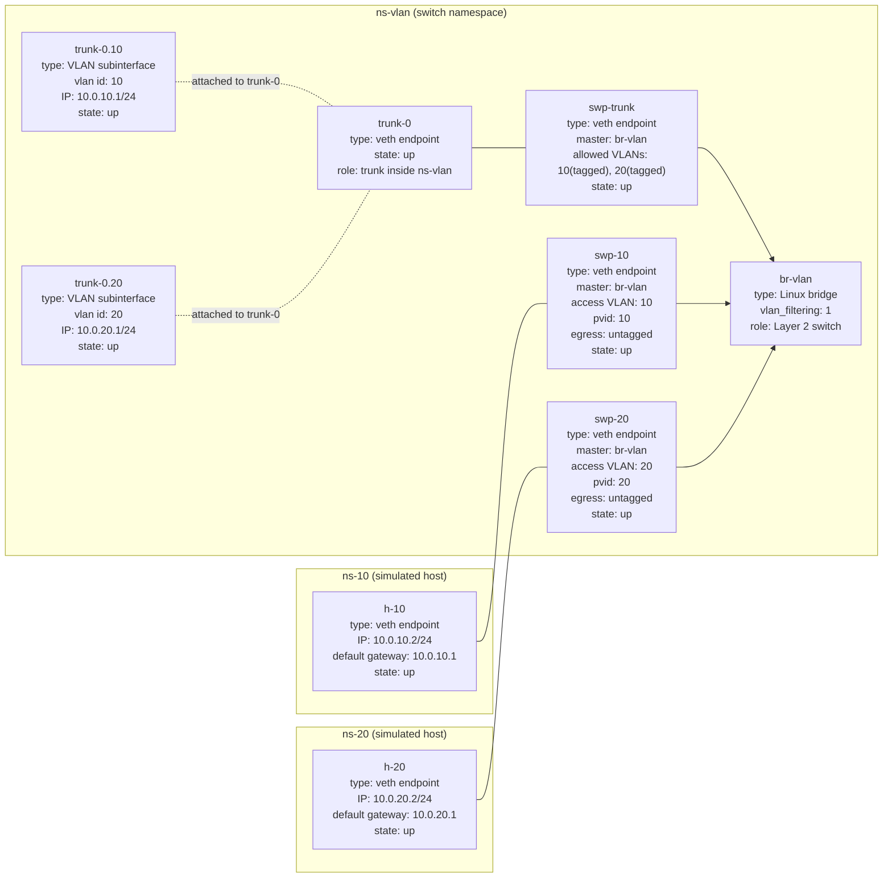

Use network namespaces, veth pairs, and a Linux bridge with vlan_filtering enabled to simulate a Layer 2 switch and hosts.

## 1. Goals
1. Verify connectivity within the same VLAN
2. Verify Layer 2 isolation across different VLANs
3. Verify VLAN tag add/remove behavior on the trunk port
4. Verify inter-VLAN connectivity after enabling Layer 3 forwarding

## 2. Build The Experiment Topology
Notes:
- ns-10: host in VLAN 10
- ns-20: host in VLAN 20
- ns-vlan: dedicated network namespace for the simulated switch domain
- br-vlan: Linux bridge inside ns-vlan, acting as the switch
- trunk-0: trunk-side interface inside ns-vlan

~~~bash
# 0) Clean up any previous experiment state
sudo ip netns delete ns-vlan
sudo ip netns delete ns-10
sudo ip netns delete ns-20

# 1) Load the VLAN module
sudo modprobe 8021q

# 2) Create namespaces
sudo ip netns add ns-vlan
sudo ip netns add ns-10
sudo ip netns add ns-20

# 3) Create the switch bridge inside ns-vlan
sudo ip -n ns-vlan link set lo up
sudo ip -n ns-vlan link add br-vlan type bridge vlan_filtering 1
sudo ip -n ns-vlan link set br-vlan up

# 4) Create the trunk link inside ns-vlan: trunk-0 <-> swp-trunk
sudo ip -n ns-vlan link add trunk-0 type veth peer name swp-trunk
sudo ip -n ns-vlan link set swp-trunk master br-vlan
sudo ip -n ns-vlan link set swp-trunk up
sudo ip -n ns-vlan link set trunk-0 up

# 5) Create an access link to ns-10: h-10 <-> swp-10
sudo ip link add h-10 type veth peer name swp-10
sudo ip link set h-10 netns ns-10
sudo ip link set swp-10 netns ns-vlan
sudo ip -n ns-vlan link set swp-10 master br-vlan
sudo ip -n ns-vlan link set swp-10 up

# 6) Create an access link to ns-20: h-20 <-> swp-20
sudo ip link add h-20 type veth peer name swp-20
sudo ip link set h-20 netns ns-20
sudo ip link set swp-20 netns ns-vlan
sudo ip -n ns-vlan link set swp-20 master br-vlan
sudo ip -n ns-vlan link set swp-20 up

# 7) Configure bridge port VLANs inside ns-vlan
# trunk port allows VLANs 10 and 20 as tagged
sudo bridge -n ns-vlan vlan add dev swp-trunk vid 10
sudo bridge -n ns-vlan vlan add dev swp-trunk vid 20

# access port swp-10: untagged + PVID 10
sudo bridge -n ns-vlan vlan add dev swp-10 vid 10 pvid untagged

# access port swp-20: untagged + PVID 20
sudo bridge -n ns-vlan vlan add dev swp-20 vid 20 pvid untagged

# 8) Create VLAN subinterfaces on trunk-0 inside ns-vlan
sudo ip -n ns-vlan link add link trunk-0 name trunk-0.10 type vlan id 10
sudo ip -n ns-vlan link add link trunk-0 name trunk-0.20 type vlan id 20
sudo ip -n ns-vlan link set trunk-0.10 up
sudo ip -n ns-vlan link set trunk-0.20 up
sudo ip -n ns-vlan address add 10.0.10.1/24 dev trunk-0.10
sudo ip -n ns-vlan address add 10.0.20.1/24 dev trunk-0.20

# 9) Configure IP addresses in ns-10 and ns-20
sudo ip -n ns-10 link set lo up
sudo ip -n ns-10 link set h-10 up
sudo ip -n ns-10 address add 10.0.10.2/24 dev h-10
sudo ip -n ns-10 route add default via 10.0.10.1

sudo ip -n ns-20 link set lo up
sudo ip -n ns-20 link set h-20 up
sudo ip -n ns-20 address add 10.0.20.2/24 dev h-20
sudo ip -n ns-20 route add default via 10.0.20.1
~~~

## 3. Validation Steps
~~~bash
# A. Check VLAN configuration inside ns-vlan
sudo bridge -n ns-vlan vlan show

# B. Check whether the trunk subinterfaces carry VLAN metadata
sudo ip -n ns-vlan -d link show trunk-0.10
sudo ip -n ns-vlan -d link show trunk-0.20

# C. Reach the gateway within the same VLAN, should succeed
sudo ip netns exec ns-10 ping -c 2 10.0.10.1
sudo ip netns exec ns-20 ping -c 2 10.0.20.1

# D. Test inter-VLAN reachability first, usually fails until forwarding is enabled
sudo ip netns exec ns-10 ping -c 2 10.0.20.2
~~~

## 4. Retest Inter-VLAN Traffic After Enabling Layer 3 Forwarding
~~~bash
# Allow forwarding only between the lab VLAN interfaces inside ns-vlan
sudo ip netns exec ns-vlan iptables -I FORWARD 1 -i trunk-0.10 -o trunk-0.20 -j ACCEPT
sudo ip netns exec ns-vlan iptables -I FORWARD 1 -i trunk-0.20 -o trunk-0.10 -j ACCEPT
~~~
~~~bash
sudo ip netns exec ns-vlan sysctl -w net.ipv4.ip_forward=1
sudo ip netns exec ns-10 ping -c 2 10.0.20.2
~~~
This makes the behavior easy to observe:
- With forwarding disabled: VLANs remain isolated
- With forwarding enabled: traffic crosses VLANs through Layer 3 routing

## 5. Capture Traffic To Observe 802.1Q Tags
~~~bash
sudo ip netns exec ns-vlan tcpdump -leni swp-trunk vlan
~~~
Generate traffic from another terminal and you should see frames carrying VLAN IDs.

## 6. Clean Up
~~~bash
sudo ip netns pids ns-vlan | xargs -r sudo kill
sudo ip netns del ns-vlan
sudo ip netns del ns-10
sudo ip netns del ns-20
~~~
~~~bash
# If ns-vlan still has running processes, terminate them before deleting the namespace.
# Once the namespace is actually freed, the virtual network objects inside it disappear as well.
~~~

## 7. Topology

